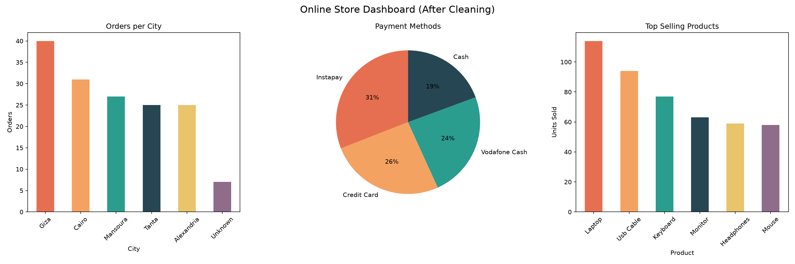

# SWYNEX Data Cleaning & Preparation (Task 1)

## Overview
Cleaned and prepared an online store orders dataset using Python (Pandas) to make it ready for analysis and dashboard creation.

## Files
- Messy_Online_Store_Orders.csv : raw data (before cleaning)
- Online_Store_Cleaned_v2.xlsx : cleaned data (after cleaning)
- Online_Store_Data_Cleaning.ipynb : cleaning code (Python/Pandas)
- all_charts.png : charts of the cleaned data

## Cleaning Steps
1. Data inspection: checked structure, column names, data types, missing values and duplicates.
2. Missing values: filled using suitable methods (mean, median, mode or "Unknown").
3. Text standardization: removed extra spaces and unified inconsistent values (e.g. cairo / CAIRO / Cairo -> Cairo) in City, Payment Method and Product.
4. Invalid values: corrected negative prices and quantities.
5. Data types: converted Order Date to datetime.

## Charts

## Tools
Python, Pandas, Matplotlib
